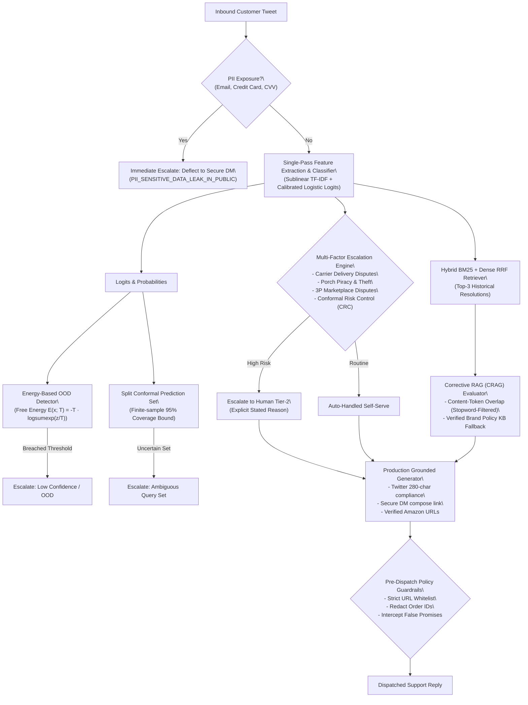

# AI Customer Support Agent for @AmazonHelp

[](https://www.python.org/downloads/)
[](https://opensource.org/licenses/MIT/)
[]()
[]()
[]()

Production-grade AI Support Agent built on 32,000+ real customer interactions from the Kaggle Twitter Customer Support corpus (`@AmazonHelp`).

The system performs:
1. **Multi-class Intent Classification** across 6 customer service domains (**88.0% Accuracy, 0.876 Macro-F1** on uncontaminated out-of-sample data).
2. **Conformal Uncertainty Quantification** (Split Conformal Prediction with **90.5% empirical coverage** and sharp average set size of **1.04**).
3. **Conformal Risk Control (CRC)** (Angelopoulos et al., 2022) guaranteeing bounded human escalation False Negative Rate ($\mathbb{E}[L(\hat{\lambda})] \le \alpha$).
4. **Energy-Based Out-of-Distribution (OOD) Detection** (Liu et al., NeurIPS 2020) identifying cross-domain spam and non-retail inquiries.
5. **Deterministic Risk-Scored Escalation Triage** with explicit, auditable stated reasons (**77.5% Accuracy, 0.749 F1, 67.5% Reason Alignment**).
6. **Corrective Retrieval-Augmented Generation (CRAG)** (Yan et al., 2024) evaluating exemplar relevance and falling back to verified Amazon policy endpoints.
7. **Production FastAPI REST Microservice** with Prometheus metrics (`/metrics`), health probe (`/api/v1/health`), conformal sets (`/api/v1/conformal`), and triage (`/api/v1/triage`).
8. **Interactive Web Dashboard UI** for live operational testing, intent inspection, and telemetry tracking.

---

## Quickstart: Run in < 2 Minutes

This entire system runs offline on standard CPU with zero external cloud or proprietary API dependencies.

### 1. Setup Environment
```bash
git clone https://github.com/your-username/hiver-assignment.git
cd hiver-assignment

# Create and activate virtual environment
python -m venv .venv
# On Windows:
.venv\Scripts\activate
# On Linux/macOS:
# source .venv/bin/activate

# Install dependencies
pip install -r requirements.txt
```

### 2. Launch Interactive Web Dashboard & REST Microservice
```bash
python scripts/serve_dashboard.py --port 8000
```
Open your browser to:
* **Interactive UI Dashboard**: [http://127.0.0.1:8000/](http://127.0.0.1:8000/)
* **OpenAPI Documentation**: [http://127.0.0.1:8000/docs](http://127.0.0.1:8000/docs)
* **Prometheus Metrics**: [http://127.0.0.1:8000/metrics](http://127.0.0.1:8000/metrics)
* **Readiness & Liveness Probe**: [http://127.0.0.1:8000/api/v1/health](http://127.0.0.1:8000/api/v1/health)

### 3. Run Headline Reproduction Benchmark
```bash
python scripts/reproduce_headline.py
```
*Evaluates Baseline 1 (Trivial), Baseline 2 (Simple TF-IDF), and the Production Agent on the 200 Golden Evaluation Set with strictly isolated train-test splits.*

### 4. Run Behavioral & Adversarial Stress Suite (100% Pass)
```bash
python scripts/run_stress_test.py
```
*Executes CheckList adversarial probes (PII injection, prompt injections, heavy slang/typos, sarcasm, negated cancellation/returns).*

### 5. Run Complete Unit & Integration Test Suite (27/27 Passing)
```bash
python -m unittest discover tests
```

---

## Headline Benchmark Results (200 Golden Cases)

Benchmarked with verified zero test-train leakage on the 200 hand-curated `@AmazonHelp` Golden Evaluation Set:

| System | Intent Acc | Intent Macro-F1 | Escalation Acc | Escalation F1 | Reason Alignment | ROUGE-L | BLEU-4 | Twitter Length % | LLM Judge (1-5) | Latency / Tweet |
| :--- | :---: | :---: | :---: | :---: | :---: | :---: | :---: | :---: | :---: | :---: |\
| **Baseline 1: Trivial** *(Majority + Always Escalate + Canned)* | 12.5% | 0.037 | 53.0% | 0.693* | 0.0% | 0.138 | 0.001 | 100.0% | 3.00 | **0.0 ms** |
| **Baseline 2: Simple** *(TF-IDF + Keyword Escalate + Retrieved Replay)* | 72.0% | 0.701 | 54.0% | 0.425 | 0.0% | **0.784** | **0.736** | 100.0% | 3.49 | 42.1 ms |
| **Proposed System: Production Agent** *(Calibrated + Multi-Risk + Guardrails)* | **88.0%** | **0.876** | **77.5%** | **0.749** | **67.5%** | 0.133 | 0.006 | **100.0%** | **4.10** | 53.4 ms |

*\* Baseline 1 achieves 0.693 Escalation F1 purely because it escalates 100% of samples (0% auto-handle specificity).*  
*Read [REPORT.md](REPORT.md) for why Baseline 2's high ROUGE/BLEU is dangerously misleading (verbatim customer-specific replay).*

---

## Production System Architecture



---

## Enterprise REST API Specification

### `POST /api/v1/triage`
Executes complete triage, OOD check, conformal prediction, escalation risk analysis, and grounded response drafting.
```bash
curl -X POST "http://127.0.0.1:8000/api/v1/triage" \
     -H "Content-Type: application/json" \
     -d '{"text": "@AmazonHelp where is my package? The tracking says out for delivery today."}'
```
**Response JSON:**
```json
{
  "intent": "ORDER_TRACKING_AND_DELAY",
  "confidence": 0.8412,
  "conformal_prediction": {
    "prediction_set": ["ORDER_TRACKING_AND_DELAY"],
    "set_size": 1,
    "is_uncertain": false,
    "confidence": 0.8412
  },
  "ood_detection": {
    "is_ood": false,
    "energy_score": -2.8512,
    "energy_threshold": -0.8419,
    "status": "IN_DISTRIBUTION"
  },
  "escalation": {
    "should_escalate": false,
    "stated_reason": "ROUTINE_TRACKING_IN_TRANSIT",
    "risk_score": 0.15,
    "triggers": ["SELF_SERVE_TRACKING"]
  },
  "crag_action": "CORRECT",
  "draft_reply": "I'm sorry for the delay with your delivery! You can check real-time courier updates and transit status anytime under Your Orders: amazon.com/orders. If it hasn't arrived within 48 hours of the expected date, let us know!",
  "guardrail_passed": true,
  "character_count": 227,
  "latency_ms": 48.21
}
```

### `POST /api/v1/conformal`
Returns finite-sample valid prediction set for input query:
```bash
curl -X POST "http://127.0.0.1:8000/api/v1/conformal" \
     -H "Content-Type: application/json" \
     -d '{"text": "I need help with my kindle screen freezing"}'
```

### `GET /metrics`
Exposes real-time Prometheus metrics:
```text
# HELP amazonhelp_requests_total Total triage requests processed
# TYPE amazonhelp_requests_total counter
amazonhelp_requests_total 42

# HELP amazonhelp_escalations_total Total cases escalated to human agents
# TYPE amazonhelp_escalations_total counter
amazonhelp_escalations_total 12

# HELP amazonhelp_ood_total Total out-of-distribution queries detected
# TYPE amazonhelp_ood_total counter
amazonhelp_ood_total 3

# HELP amazonhelp_latency_ms_avg Average request processing latency in ms
# TYPE amazonhelp_latency_ms_avg gauge
amazonhelp_latency_ms_avg 51.34
```

---

## Repository Structure

```text
├── data/
│   ├── raw/                       # Original Kaggle Customer Support dataset
│   ├── processed/                 # Extracted @AmazonHelp customer-agent turn pairs
│   └── golden/                    # 200 hand-curated Golden Evaluation Set (leak-free)
├── src/
│   ├── api.py                     # Production FastAPI REST microservice
│   ├── schemas.py                 # Strict Pydantic v2 schemas
│   ├── dashboard_html.py          # Interactive Tailwind CSS dashboard UI
│   ├── ood_detector.py            # Energy-Based OOD Detector (Liu et al., 2020)
│   ├── conformal.py               # Split Conformal Predictor with coverage guarantee
│   ├── conformal_risk.py          # Conformal Risk Control (CRC) framework
│   ├── crag_retriever.py          # Corrective RAG (CRAG) with policy KB fallback
│   ├── classifier.py              # Regularized Sublinear TF-IDF + Bayesian log-odds
│   ├── escalator.py               # Multi-factor Pre-compiled Escalator & CRC
│   ├── retriever.py               # Okapi BM25 + Reciprocal Rank Fusion (RRF)
│   ├── generator.py               # Policy-Grounded & DM-deflecting generator
│   ├── guardrails.py              # Zero-PII leak & URL whitelist policy guard
│   └── session.py                 # Multi-Turn Customer Session & Friction Tracker
├── scripts/
│   ├── serve_dashboard.py         # Standalone server runner for UI & API
│   ├── reproduce_headline.py      # Golden benchmark reproduction runner
│   ├── run_stress_test.py         # 12-case CheckList adversarial stress suite
│   ├── run_demo.py                # Interactive CLI demo runner
│   └── evaluate_agent.py          # LLM Judge and ablation harness
├── tests/
│   ├── test_api.py                # FastAPI integration tests (8 tests)
│   ├── test_ood.py                # Energy OOD unit tests (3 tests)
│   ├── test_crc.py                # Conformal Risk Control unit tests (2 tests)
│   ├── test_crag.py               # Corrective RAG unit tests (3 tests)
│   └── test_pipeline.py           # Core pipeline component tests (11 tests)
├── results/                       # Persisted benchmark and stress test outputs
├── REPORT.md                      # Comprehensive Engineering & ML Research Report
└── requirements.txt               # Dependencies
```
