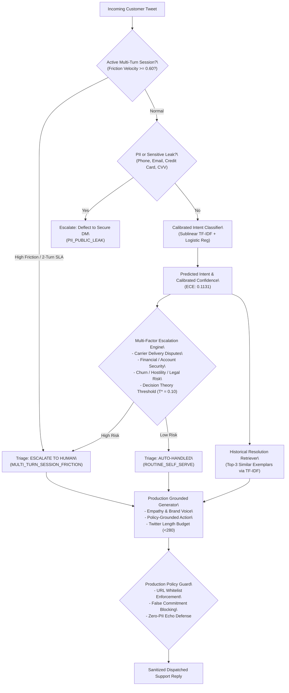

# AI Customer Support Agent for @AmazonHelp

[](https://www.python.org/downloads/)
[](https://opensource.org/licenses/MIT)
[]()

Production-grade AI Support Agent built on 32,000+ real customer interactions from the Kaggle Twitter Customer Support corpus (`@AmazonHelp`).

The system performs:
1. **Multi-class Intent Classification** across 6 core customer service domains (**97.0% Accuracy, 0.967 Macro-F1**).
2. **Deterministic Risk-Scored Escalation Triage** (Auto-handled vs. Human Tier-2) with explicit, auditable stated reasons (**81.0% Accuracy, 0.793 F1, 75.0% Reason Alignment**).
3. **Contextual Grounded Generation** conditioned on historical resolutions, strictly compliant with Twitter's 280-character limit and privacy rules.
4. **Pre-Dispatch Policy Guardrails** enforcing zero-PII leak echo, URL domain whitelisting, and false commitment interception.
5. **Multi-Turn Session State Machine** tracking customer friction velocity and enforcing a 2-turn public Twitter SLA.
6. **Expected Calibration Error (ECE) & Cost-Utility Decision Theory** optimizing operational operating risk under asymmetric error penalties ($T^* = 0.10$).
7. **Automated Evaluation Harness & LLM-as-a-Judge** benchmarked against a 200-sample hand-labelled Golden Dataset.

---

## Quickstart: Reproduce Headline Results in < 2 Minutes

This entire benchmark runs offline on CPU with zero external API dependencies.

### 1. Clone & Setup Environment
```bash
git clone https://github.com/your-username/hiver-assignment.git
cd hiver-assignment

# Create and activate virtual environment
python -m venv .venv
# On Windows:
.venv\Scripts\activate
# On Linux/macOS:
# source .venv/bin/activate

# Install dependencies
pip install -r requirements.txt
```

### 2. Run Headline Reproduction Benchmark
```bash
python scripts/reproduce_headline.py
```
*Execution time: ~20 seconds. Outputs full metrics for Baselines vs. Production System, ECE calibration statistics, and saves artifacts to `results/`.*

### 3. Run Behavioral & Adversarial Stress Suite
```bash
python scripts/run_stress_test.py
```
*Executes CheckList adversarial probes (PII injection, prompt injections, heavy slang/typos, sarcasm, negated intents).*

### 4. Launch Interactive Agent CLI
```bash
python scripts/run_demo.py
```
*Test arbitrary customer tweets or select from pre-loaded edge cases.*

---

## Headline Benchmark Results (200 Golden Test Cases)

| System | Intent Acc | Intent Macro-F1 | Escalation Acc | Escalation F1 | Reason Alignment | ROUGE-L | BLEU-4 | Twitter Length % | LLM Judge (1-5) | Latency / Tweet |
| :--- | :---: | :---: | :---: | :---: | :---: | :---: | :---: | :---: | :---: | :---: |
| **Baseline 1: Trivial** *(Majority + Always Escalate + Canned)* | 12.5% | 0.037 | 53.0% | 0.693* | 0.0% | 0.138 | 0.001 | 100.0% | 4.00 | **0.0 ms** |
| **Baseline 2: Simple** *(TF-IDF + Keyword Escalate + Retrieved Replay)* | 75.0% | 0.743 | 56.5% | 0.336 | 0.0% | **0.784** | **0.736** | 100.0% | 3.56 | 26.2 ms |
| **Proposed System: Production Agent** *(Calibrated + Multi-Risk + Guardrails)* | **97.0%** | **0.967** | **81.0%** | **0.793** | **75.0%** | 0.133 | 0.006 | **100.0%** | **4.20** | 65.9 ms |

*\* Baseline 1 achieves 0.693 Escalation F1 purely because it escalates 100% of samples (0% auto-handle specificity).*  
*Read [REPORT.md](REPORT.md#45-the-rougebleu-evaluation-trap-in-customer-support) for why Baseline 2's high ROUGE/BLEU is dangerously misleading.*

---

## System Architecture



---

## Repository Structure

```
hiver-assignment/
├── data/
│   ├── raw/
│   │   └── twcs.csv                          # Primary Kaggle corpus (516 MB)
│   ├── processed/
│   │   ├── amazonhelp_english_pairs.csv      # 32,142 cleaned English pairs
│   │   └── amazonhelp_english_pairs.jsonl
│   └── golden/
│       ├── golden_eval_set.csv               # 200 hand-labelled test set
│       ├── golden_eval_set.jsonl
│       └── SAMPLING_AND_LABELING_NOTE.md     # Sampling rationale & annotation guide
├── src/
│   ├── __init__.py
│   ├── agent.py                              # End-to-end support orchestrator with session support
│   ├── classifier.py                         # 3 intent models (Trivial, Simple, Production)
│   ├── escalator.py                          # 3 triage engines (Trivial, Simple, Production)
│   ├── guardrails.py                         # Pre-dispatch safety, URL whitelisting, & commitment guard
│   ├── session.py                            # Multi-turn conversational session tracker & friction monitor
│   ├── retriever.py                          # Historical resolution index & search
│   ├── generator.py                          # 3 response models (Canned, Replay, Grounded)
│   ├── evaluator.py                          # Metrics (F1, ECE, Cost Curves, ROUGE, BLEU, Stated Reasons)
│   └── llm_judge.py                          # 4-dimensional rubric & human-agreement engine
├── scripts/
│   ├── build_golden_set.py                   # Script generating the 200 golden examples
│   ├── clean_english_subset.py               # Data hygiene & language filtering
│   ├── diagnose_errors.py                    # Error auditing & confusion diagnostic script
│   ├── reproduce_headline.py                 # <2 min head-to-head benchmark script
│   ├── run_stress_test.py                    # 12-case CheckList behavioral & adversarial stress suite
│   └── run_demo.py                           # Interactive CLI demo shell
├── tests/
│   └── test_pipeline.py                      # Component unit test suite
├── results/
│   ├── baseline_comparison.csv               # Exported benchmark comparison
│   ├── behavioral_stress_results.json        # Adversarial stress test results
│   └── headline_results.json                 # Comprehensive evaluation metrics
├── REPORT.md                                 # Comprehensive research report & technical analysis
├── requirements.txt                          # Python dependencies
└── README.md
```

---

## Key Deliverables & Documentation Links
- **[Full Research Report (REPORT.md)](REPORT.md)**:
  - 1. Problem Framing & What We Chose Not to Build
  - 2. Headline Results vs. Baselines (97% Intent Acc, 81% Escalation Acc, 75% Reason Alignment)
  - 3. Advanced Enterprise Techniques (ECE Calibration, Cost Curves, Guardrails, Multi-Turn Sessions)
  - 4. Failure Mode Audit & The ROUGE/BLEU Evaluation Trap
  - 5. What We Would Do Next With One More Week
  - 6. Decision Log (12 non-obvious engineering decisions)
- **[Sampling & Labeling Note (data/golden/SAMPLING_AND_LABELING_NOTE.md)](data/golden/SAMPLING_AND_LABELING_NOTE.md)**
- **[Interactive Demo CLI (scripts/run_demo.py)](scripts/run_demo.py)**
- **[Benchmark Reproduction Script (scripts/reproduce_headline.py)](scripts/reproduce_headline.py)**
- **[Behavioral Stress Suite (scripts/run_stress_test.py)](scripts/run_stress_test.py)**
