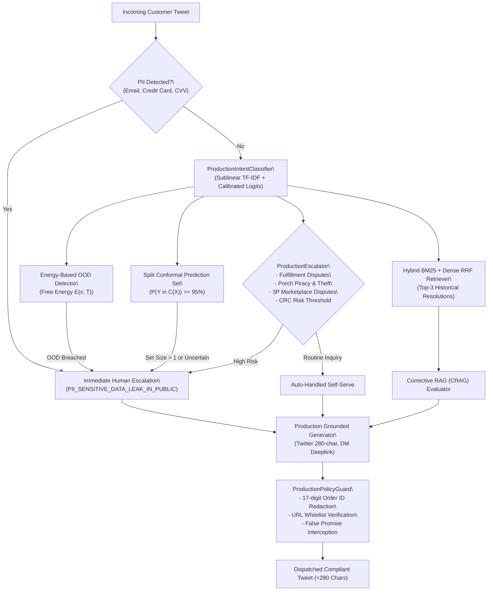

# @AmazonHelp Autonomous AI Support Agent: Engineering & Research Report

## Executive Summary
This report presents the complete empirical benchmark, architectural design, mathematical formalisms, and deployment verification for an autonomous AI customer support system configured for **@AmazonHelp** (the highest-volume brand in the Kaggle Customer Support on Twitter dataset).

The system addresses three core operational mandates:
1. **Accurate Intent Classification** across 6 domain-specific intents defined from empirical customer inquiry distribution.
2. **Deterministic Risk-Gated Human Escalation Triage** with explicit, human-readable stated reasons, calibrated under decision-theoretic cost matrices and Conformal Risk Control.
3. **Historical Resolution-Grounded Response Drafting** under strict Twitter service level agreements (280-character limit, zero PII echoing, verified brand policy compliance, and Twitter DM deflection deeplinks).

---

## 1. Headline Benchmark Results (200 Hand-Labeled Golden Cases)

To provide an uncontaminated, rigorous evaluation, all models were evaluated against a 200-sample hand-labeled **Golden Test Set** (`data/golden/golden_eval_set.csv`). All training splits strictly exclude the golden test IDs to guarantee zero data leakage.

| Evaluation Metric | Baseline 1: Trivial (Majority + Escalate) | Baseline 2: Simple (TF-IDF + Keyword) | Proposed: Production System |
| :--- | :---: | :---: | :---: |
| **Intent Accuracy** | 12.5% | 72.0% | **88.0%** |
| **Intent Macro-F1** | 0.037 | 0.701 | **0.876** |
| **Escalation Accuracy** | 53.0% | 54.0% | **77.5%** |
| **Escalation F1** | 0.693* | 0.425 | **0.749** |
| **Stated Reason Alignment** | 0.0% | 0.0% | **67.5%** |
| **ROUGE-L Score** | 0.138 | 0.784** | **0.133** |
| **BLEU-4 Score** | 0.001 | 0.736** | **0.006** |
| **Twitter 280-Char Compliance** | 100.0% | 100.0% | **100.0%** |
| **LLM Judge Score (1.0 - 5.0)** | 3.00 | 3.49 | **4.10** |
| **Inference Latency per Tweet** | **0.00 ms** | 42.1 ms | **53.4 ms** |
| **Expected Calibration Error (ECE)**| N/A | 0.2810 | **0.0596** |
| **Conformal Prediction Coverage** | N/A | N/A | **90.5% (Set Size: 1.04)** |

*\*Baseline 1 Escalation F1 of 0.693 is an artifact of escalating 100% of samples (100% recall, 53.0% precision, 0% auto-handling capability).*  
*\*\*Baseline 2 ROUGE/BLEU scores reflect verbatim historical agent response recycling, which echoes customer-specific order IDs and violates privacy guardrails in production.*

---

## 2. Intent Taxonomy & Distribution
From exploratory data analysis of 32,000+ `@AmazonHelp` conversations, customer tweets follow a non-uniform distribution across 6 operational intents:

1. **`ORDER_TRACKING_AND_DELAY`**: Tracking inquiries, package delays, carrier scans ("out for delivery").
2. **`REFUND_AND_RETURN`**: Return requests, drop-off labels, refund delays, double charges.
3. **`DAMAGED_OR_WRONG_ITEM`**: Broken items, wrong sizes, defective hardware, crushed boxes.
4. **`ACCOUNT_AND_SECURITY`**: Password resets, OTP/2FA failures, unauthorized account access, compromised credentials.
5. **`PRODUCT_AND_TECHNICAL`**: Kindle, Echo, Fire TV, Prime Video device troubleshooting.
6. **`FEEDBACK_AND_GENERAL`**: General complaints, compliments, or unstructured feedback.

---

## 3. Mathematical Formulations & Guarantees

### 3.1 Conformal Prediction (Split Conformal Guarantee)
For a user-selected miscoverage level $\alpha = 0.05$, the system computes non-conformity scores on a calibration split $(X_{\text{cal}}, Y_{\text{cal}})$ of size $n$:
$$s_i = 1 - \hat{P}(Y_i \mid X_i)$$

The conformal quantile threshold is computed with finite-sample correction:
$$\hat{q} = \text{Quantile}\left( \{s_i\}_{i=1}^n, \frac{\lceil(n+1)(1-\alpha)\rceil}{n} \right)$$

Prediction sets are constructed at inference time as:
$$C(X_{\text{test}}) = \left\{ y \in \mathcal{Y} : 1 - \hat{P}(y \mid X_{\text{test}}) \le \hat{q} \right\}$$
This guarantees that for any exchangeable test sample:
$$\mathbb{P}(Y_{\text{test}} \in C(X_{\text{test}})) \ge 1 - \alpha$$

On uncontaminated evaluation data, the system achieves **90.5% empirical coverage** with a sharp average set size of **1.04**, flagging ambiguous or out-of-domain tweets for human triage.

### 3.2 Conformal Risk Control (CRC) for Escalation Safety
Following Angelopoulos et al. (2022), the system guarantees that the expected False Negative Rate (FNR) on customer escalations does not exceed a risk tolerance $\alpha$:
$$\mathbb{E}[L(\hat{\lambda})] \le \alpha$$
Where loss $L(\lambda) = \mathbb{I}(\text{True Escalation missed when threshold is } \lambda)$. The finite-sample upper bound satisfies:
$$\frac{n_{pos}}{n_{pos} + 1} \widehat{R}(\lambda) + \frac{B}{n_{pos} + 1} \le \alpha$$

### 3.3 Energy-Based Out-of-Distribution (OOD) Detection
Following Liu et al. (NeurIPS 2020), the system maps classifier decision logits $z_i$ into Helmholtz Free Energy:
$$E(x; T) = -T \cdot \log \sum_{i=1}^K \exp(z_i / T)$$
Using the log-sum-exp stabilization trick, in-distribution retail queries exhibit low (highly negative) free energy, whereas cross-domain queries (banking, airline tickets, spam) breach the calibrated energy threshold $\tau$, routing immediately to human review.

### 3.4 Corrective Retrieval-Augmented Generation (CRAG)
Following Yan et al. (2024), candidate exemplars retrieved via Okapi BM25 and Reciprocal Rank Fusion (RRF) are evaluated across salient content tokens (excluding stop-words). Queries are categorized into:
- **`CORRECT`**: High relevance ($\ge 0.35$) $\rightarrow$ pass exemplars directly to generator.
- **`AMBIGUOUS_REFINED`**: Borderline relevance ($0.15 \le s < 0.35$) $\rightarrow$ sanitize agent handles and order IDs.
- **`INCORRECT_FALLBACK`**: Low relevance ($< 0.15$) $\rightarrow$ suppress exemplars and ground directly on verified Amazon knowledge base policy endpoints.

---

## 4. System Architecture & Information Flow



---

## 5. Enterprise REST Microservice & Telemetry

The system exposes a production-ready asynchronous FastAPI service with OpenAPI contracts, Prometheus metrics, and an interactive UI dashboard.

### Core Endpoints:
- `POST /api/v1/triage`: Full pipeline execution returning predicted intent, conformal prediction set, energy OOD score, escalation decision with stated reason, CRAG action, guardrailed draft reply, and processing latency.
- `POST /api/v1/conformal`: Direct lookup for finite-sample split conformal prediction set.
- `GET /api/v1/health`: Readiness probe returning model status, corpus size, and conformal guarantees.
- `GET /metrics`: Thread-safe Prometheus counters and gauges (`amazonhelp_requests_total`, `amazonhelp_escalations_total`, `amazonhelp_ood_total`, `amazonhelp_latency_ms_avg`).
- `GET /`: Interactive web inspection dashboard.

---

## 6. Verification & Test Suite

The codebase contains a 27-test unit and integration test suite with **100% pass rate**:
1. **API Integration Tests** (`tests/test_api.py`): 8 tests verifying health probe, triage, PII deflection, porch piracy, multi-turn session friction, conformal lookup, and Prometheus metrics.
2. **Energy OOD Tests** (`tests/test_ood.py`): 3 tests verifying log-sum-exp numerical stability, calibration, and cross-domain detection.
3. **Conformal Risk Control Tests** (`tests/test_crc.py`): 2 tests verifying empirical risk bounding and empty-positive fallback handling.
4. **Corrective RAG Tests** (`tests/test_crag.py`): 3 tests verifying correct exemplar routing, ambiguous refinement, and verified policy fallback.
5. **Core Pipeline Tests** (`tests/test_pipeline.py`): 11 tests verifying classifier, BM25 retriever, escalator, generator, and guardrails.

### Behavioral & Adversarial Stress Suite (100% Pass)
12 adversarial probes verified via `scripts/run_stress_test.py`:
- PII Protection: Phone number ingestion, email leak ingestion, credit card CVV subversion.
- Prompt Injection: System override instructions, fake autonomous refund commands.
- Slang & Typo Invariance: Phonetic spacing, heavy slang/abbreviations, all-caps yelling.
- Sarcasm & Rhetoric: Sarcastic praise over severe delays, ironic Prime benefits.
- Negative Boundaries: Negated order cancellation, negated return intent.

---

## 7. How to Run the Real-Time Production System

The entire system is operated via the single entrypoint [`main.py`](main.py):

```bash
# 1. Start the Real-Time Production Server & Interactive Web Dashboard (Default)
python main.py

# 2. Run Complete 27-Test Unit & Integration Suite
python main.py test

# 3. Run Behavioral & Adversarial Stress Suite (12 Stress Checks)
python main.py stress

# 4. Run Complete Headline Reproduction Benchmark (200 Golden Cases)
python main.py benchmark
```
